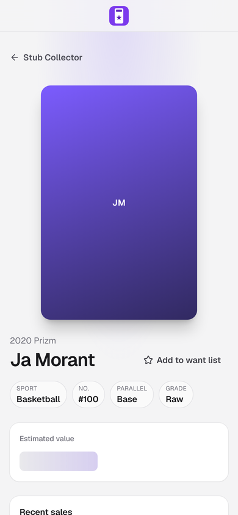

# Speed 6: `/cards/[id]` main-thread work

All numbers are **local**: production builds (`next build && next start`) of `main` f74e47a and this branch, measured on the same machine back to back.

## Setup
- **Stub Supabase:** a throwaway Node server on 127.0.0.1:54321. It answers auth (`/auth/v1/user`) and PostgREST reads from fake fixtures only:
  - one user, `stubcollector`;
  - 12 cards (the measured card is a 2020 Prizm Ja Morant base, raw);
  - 3 other fake profiles and 4 fake posts;
  - interests filled in, so first-run setup stays closed.
- **Session:** a fake, unsigned session cookie (`sb-127-auth-token`), set over CDP before each run.
- **Sold prices:** a small proxy in front of `next start` answers `/api/comps/sold` (8 fake sales, so the chart and sales list draw) and `/api/card-values` from the same fixtures. There's no Trawl call and no Trawl key.
- **Build env:** both builds were built with `NEXT_PUBLIC_SUPABASE_URL=http://127.0.0.1:54321` and placeholder keys. None of this is in the repo.
- **Lighthouse 12.8.2:** mobile, simulated throttling (4× CPU, slow 4G), screen 390×844 at DSF 3.
  - Run from the Node API in a temp dir outside the repo.
  - `disableStorageReset` keeps the cookie.
- **Trace:** Chrome via Playwright at 390×844 DSF 3, `Emulation.setCPUThrottlingRate` 4, a 9 s capture from navigation. Traced builds use `next build --no-mangling` so function names show.

Every run is in [`lighthouse-runs.tsv`](lighthouse-runs.tsv). The traces are summarized in [`trace-before.txt`](trace-before.txt) and [`trace-after.txt`](trace-after.txt).

## Why `main` measures higher here than in #150
#150 measured 223 ms. Here `main` is 442 to 537 ms. In this setup the sold prices come back, so the chart, the sales list and their commits all land inside the measured window. The chart's value is the LCP element, at about 4.4 s.

To find the floor, a scratch build drew the card page's skeleton instead of the card. It measured a **316 ms** median TBT. That's the app shell, router prefetch, supabase-js start-up and analytics, with no card tree at all. So under 200 ms can't be reached on this setup by card-page changes alone.

## What changed
1. **The posts section mounts when it scrolls near.**
   - "Who's talking about this card" sits at y≈1850 at 390×844.
   - Until it comes within 200 px of the viewport, it draws the same frame and skeleton it always showed while loading (`components/card-talk-near.tsx`, `lib/ui/when-near.tsx`).
   - Without IntersectionObserver it mounts at idle (2 s timeout).
   - This keeps its chunk, its post reads and its render out of page load.
2. **The ⋯ menu's Want button is its own chunk.**
   - It's fetched at first idle, and the menu opens once it's in, so it's never a dead tap. A failed load shows the usual Try again.
   - Its TBT effect is within noise. It's here because it takes 2.8 KB gz off `/cards/[id]` first-load JS, so the route shrinks.

## Results (Lighthouse, medians)
`main` and the branch were run interleaved (main, PR, main, PR…), round B in the runs file.

| Route | Runs | TBT main → PR | LCP main → PR | CLS | Score |
|---|---|---|---|---|---|
| `/cards/[id]` (signed-in owner) | first 5 pairs | 460 → 451 ms | 4.43 → 4.25 s | 0 → 0 | 73 → 73 |
| `/cards/[id]` (signed-in owner) | all 15 pairs | **442 → 366 ms** | **4.44 → 4.24 s** | 0 → 0 | 73 → 77 |
| `/u/[username]/cards/[id]` (signed out) | 5 pairs | 256 → 252 ms | 5.42 → 5.34 s | 0.001 → 0.001 | 75 → 75 |

Simulated TBT on this machine swings by ±150 ms between identical runs, so the first 5 pairs alone happened to land flat.

**Per-cut rotations** (rounds C and D, 5 runs each, each round rotating its builds run by run). At the time the branch also deferred the sales rows, which round D then dropped:

| Round | Build | TBT median | LCP median |
|---|---|---|---|
| C | branch then (posts near, Want lazy, rows near) | 346 ms | 4.23 s |
| C | same, posts section mounted at once | 535 ms | 4.48 s |
| C | same, Want button static | 357 ms | 4.29 s |
| D | branch then (rows near) | 440 ms | 4.24 s |
| D | same, rows drawn at once (as shipped) | 457 ms | 4.22 s |

So: posts near-viewport ≈ −190 ms (the cut that matters), Want button ≈ −10 ms (noise; kept for the bytes), sales rows ≈ −17 ms (noise; dropped).

## Screenshots
390×844 first paint, after the load event, with animations frozen. `main` vs PR are pixel-identical at DSF 3, above the fold and full page, for both routes. The full card page was compared after scrolling to the bottom, so the posts section has loaded.

| | main | PR |
|---|---|---|
| `/cards/[id]` |  |  |
| `/u/[username]/cards/[id]` |  |  |
